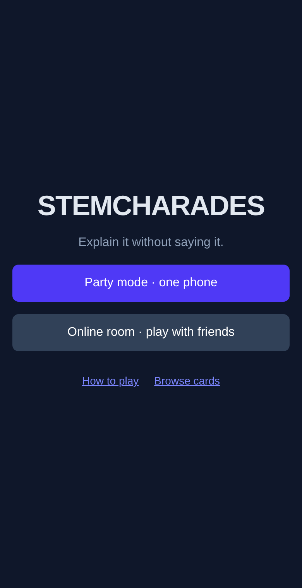
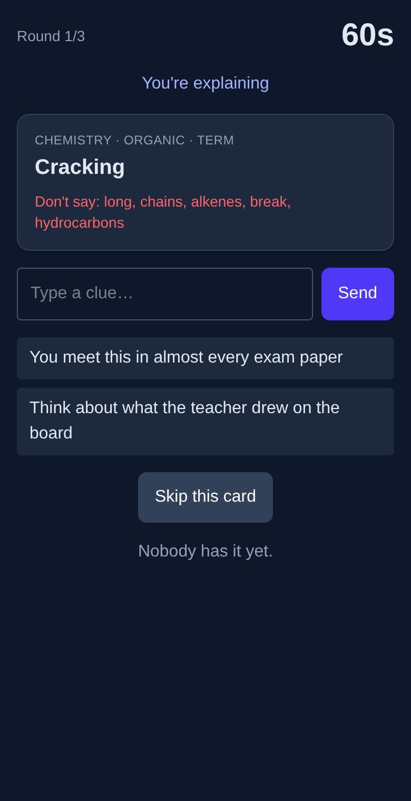
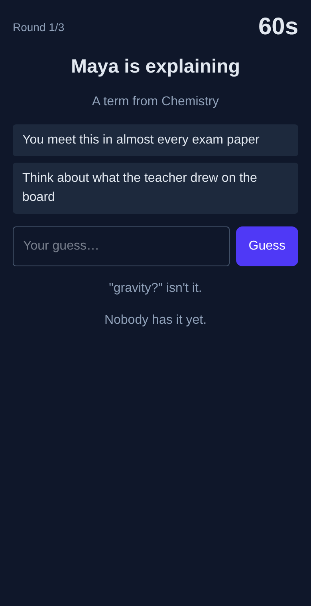
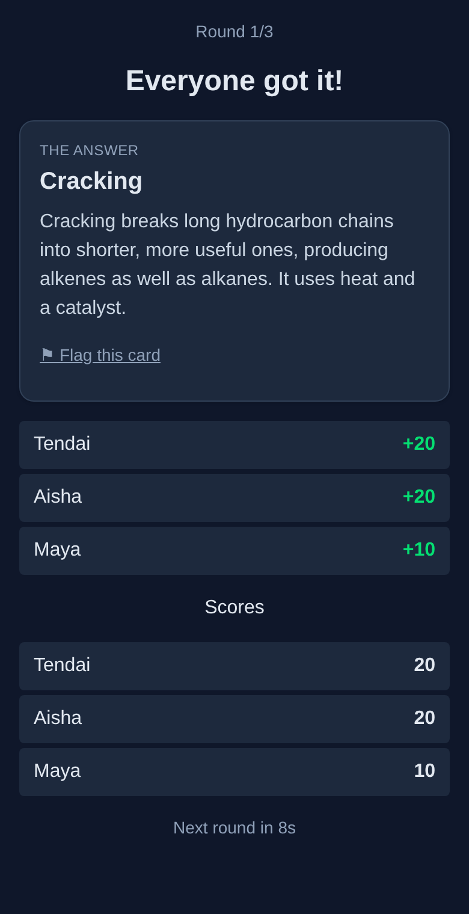

<p align="center">
  
</p>
<h1 align="center">STEMCHARADES</h1>
<p align="center"><strong>Explain it without saying it.</strong> A multiplayer party game for STEM revision.</p>
<p align="center">
  <a href="https://github.com/dalie07/stemcharades/actions/workflows/ci.yml"></a>
</p>

One player explains a term, a formula or a question without using the forbidden words. Everyone else races to
guess it. Then the round ends with the right answer explained, so even a wrong guess teaches something.
*If you can explain it, you understand it.*

<p align="center">
  
  
  
  
</p>

## What it does

- **Party mode.** One phone passed around the room. Works offline after the first load and installs like an app.
- **Online rooms.** 2 to 12 players on their own devices, joined with a 5-character code. No account needed.
- **A teaching loop.** Every card carries forbidden words, accepted answers and a model explanation. Games end with
  a revision list of the cards the group missed.
- **Fair by construction.** The server picks cards, runs the timer, judges guesses and keeps score. The answer is
  never sent to a guesser's device, so there is nothing to find in the network traffic.
- **Choose exactly what to revise.** General (everything), or narrow it down: Primary, Secondary, University or
  Advanced, then a subject or course, then topics. One decision per screen; every step is optional, shows its card
  count, and can be shared as a link. Online rooms add a QR code to join.
- **Learn as you play.** Mastery stars for every topic, a "revise my misses" deck (missed cards also come back in
  later games until you get them), a daily streak, and highlights at the end of each game. Kept on the device: no
  account needed.
- **A classroom look.** A green chalkboard at night, a whiteboard by day, following the device. Fonts chosen for
  young readers, a colour per subject, gentle animations and optional sound and vibration.
- **400+ cards and growing** across Maths, Physics, Chemistry, Biology and Computing, with formulas typeset by KaTeX.
  Every card is checked by machine (schema, curriculum map, unambiguous answers, safe language) and then by a person.
- **Optional accounts.** Sign in with GitHub or Google to keep your game history, a personal revision list, and
  private decks for your class. Guests play exactly the same game.
- **Private by design.** No ads, analytics or trackers, and no email ever. Accounts can be deleted in one step;
  the in-app privacy page says exactly what is kept.
- **Runs for $0.** One Node process on a free Render web service. No database is needed to play.

> [!NOTE]
> **Content status.** All 407 cards were drafted with AI help and then checked by hand against course material.
> Only cards marked `reviewed` are ever served; see the [content guide](docs/content-guide.md). Spotted a mistake?
> Every card has a **Flag this card** button.

## Quick start

Requires Node.js 22 or newer.

```bash
git clone https://github.com/dalie07/stemcharades.git
cd stemcharades
npm install
cp .env.example .env        # optional; the defaults work

npm run dev                 # server on :3000, client with hot reload on http://localhost:5173
```

To run it the way production does, as one process serving the built app:

```bash
npm run build
ALLOW_DRAFT_CARDS=1 npm start        # http://localhost:3000
```

| Command | What it does |
|---|---|
| `npm run typecheck` · `npm run lint` | TypeScript in strict mode, ESLint |
| `npm test` | Unit and integration tests (Vitest) for every workspace |
| `npm run test:coverage` | Game-engine coverage; fails under 90% |
| `npm run test:e2e` | Browser tests with several real browsers per test (Playwright) |
| `npm run validate:cards` | Card schema, duplicate ids, shared answers, forbidden words that are answers |
| `npm run check` | Everything CI checks except the browser tests |

## How it is built

One Node process serves the React app, a small REST API and the Socket.IO connection from the same origin.

```
client/    React + Vite + Tailwind. Screens, the offline Party engine, KaTeX cards, the service worker.
server/    Express + Socket.IO. Rooms, the round engine, clue filter, guess matcher, rate limits, optional accounts.
shared/    Zod schemas, event names, scoring, the card picker and text normalising, used by both sides.
content/   The card decks as JSON: version-controlled, schema-checked and reviewed like code.
e2e/       Playwright tests that play real games across several browsers.
docs/      Architecture, game rules, content guide, test plan, decision records.
```

The rules live in a pure engine: the current state and one event go in, a new state and messages come out, with
no sockets, clock or randomness inside. That is why the whole rule set is tested in milliseconds. After every
change the server sends each player their own view of the room, so the explainer's card exists only in the
explainer's view.

- [Architecture](docs/architecture.md): components, data flow, security model and the reasons behind them
- [Game rules](docs/game-rules.md): scoring, timing, clue and guess rules, written for players
- [Test plan](docs/test-plan.md): every test scenario, the measured quality metrics and the known limitations
- [Content guide](docs/content-guide.md): how to write and review a card
- [Accounts setup](docs/setup-accounts.md): the optional database and sign-in

## Deploy

The repository includes a [Render blueprint](render.yaml) for one free web service.

1. In Render choose **New → Blueprint** and select your fork.
2. In a fork, change `VITE_GITHUB_REPO` in `render.yaml` to your own `owner/repo`, so card flags reach you.
3. Open the service URL.

Two things to know about the free tier. The instance sleeps after 15 quiet minutes and takes about a minute to
wake; the app shows a wake screen meanwhile, and Party mode needs no server at all. Live rooms are kept in memory,
so a restart ends any game in progress; players are told and returned to the home screen. Deploy outside play hours.

Configuration is by environment variable; [`.env.example`](.env.example) lists every one.

## Contributing

Bug reports and card corrections are welcome as issues; see [CONTRIBUTING.md](CONTRIBUTING.md) for how to work on
the code or the cards, and [SECURITY.md](SECURITY.md) to report a vulnerability privately. For code, run
`npm run check` and `npm run test:e2e` before opening a pull request. The rules that never bend:

1. The server is authoritative. If the client could decide it, a player could fake it.
2. The answer never reaches a guesser's connection.
3. Every REST body and socket event is validated against a shared schema.
4. The round engine stays pure.
5. No paid services, and one service only.

## License

[MIT](LICENSE) © 2026 Dalie_07
